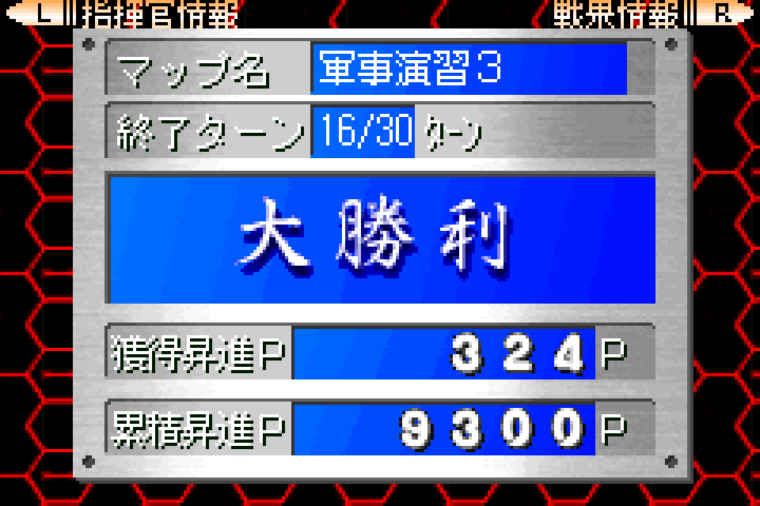
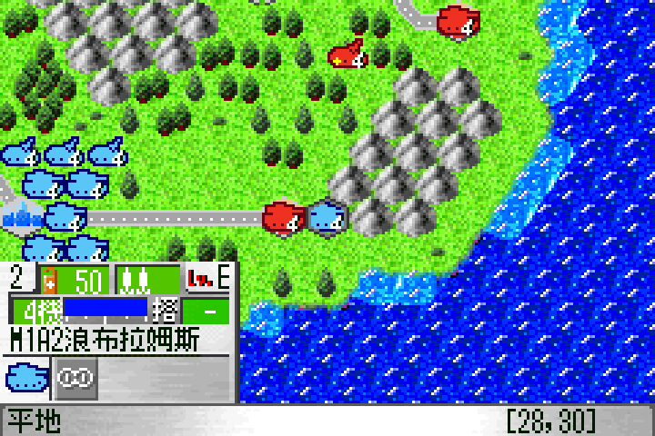
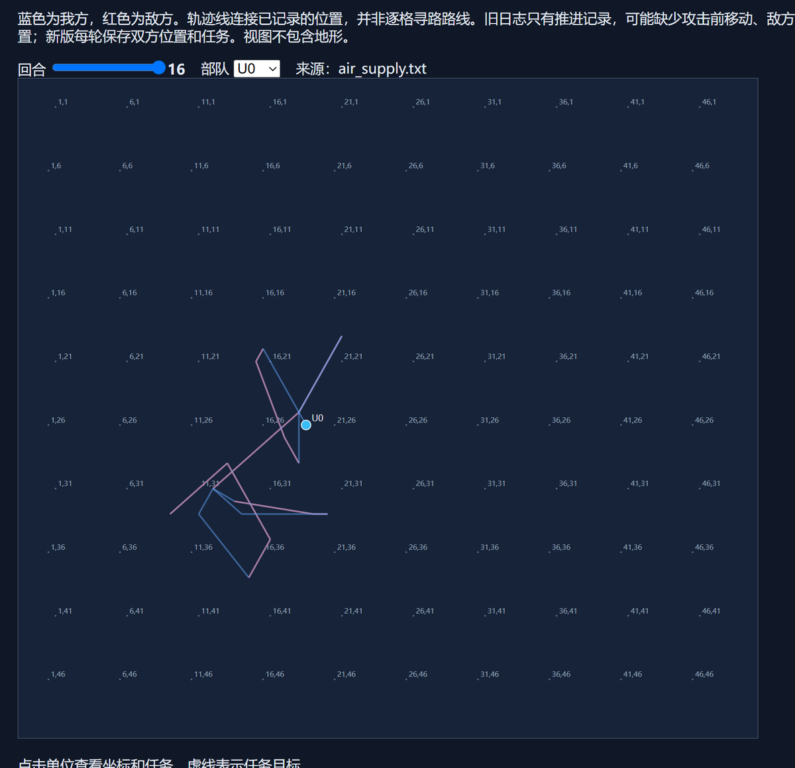
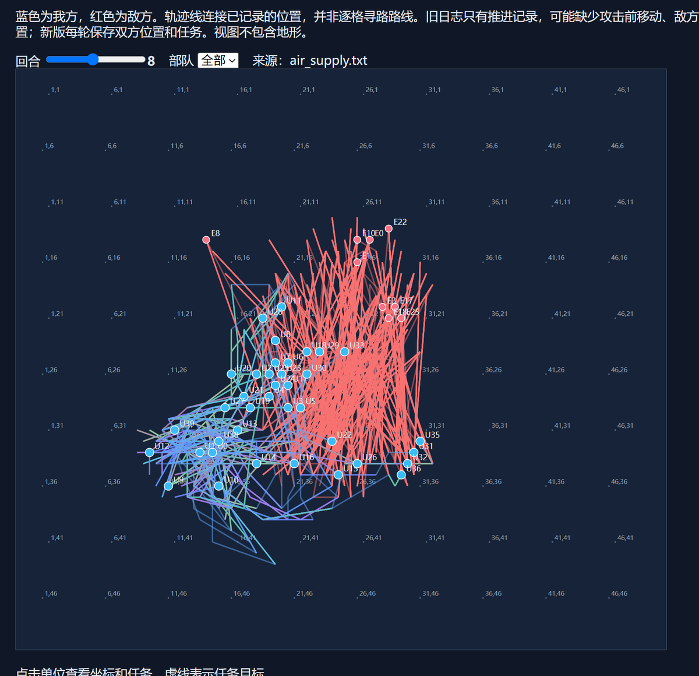

# GBA AI — 让脚本直接调用游戏的原生函数通关《大战略》

> **Reverse engineering > reimplementation.**
> This project plays the GBA strategy game *Daisenryaku* (大戦略) by calling the
> game's **own** move / battle / capture / resupply routines — not by rewriting
> its rules in a simulator.



## 它是什么

一个 Windows 上的 GBA 自动化实验：BizHawk + Lua 负责读写内存和驱动帧，
Python 负责调度与记录，策略层负责决定“谁去哪、打谁、何时补给”。

关键点在于**不做规则建模**。脚本通过逆向得到的地址，直接调用 ROM 里的原生函数：

- 移动：汇编级落格，真实消耗移动力 / 燃料
- 战斗：原生伤害结算，真实扣弹、反击、行动标志
- 占领：原生占领函数，真实转移建筑归属
- 补给：原生补给车 → 飞机/地面单位的货物与资金结算
- 结束回合：原生回合推进

因此日志里的每一次攻击都带着游戏自己算出来的结果，例如：

```
T5 U6(id187)->E4(id188) OK DIRECT U6 E4 | my HP 11->10 enemy HP 3->0
        ammo 2->1 counter 3->0 acted=false
OK VICTORY 全歼/战斗结算 turn=5 friendly=18 enemies=0 points=1772
```

## 实测结果

| 场景 | 结果 | 回合 | 剩余单位 | 取得 P |
|---|---|---|---|---|
| 军事演习 1（首次通关） | 大勝利 | 3 | 16 | 1706 |
| 军事演习 1（2026-11-01 复跑） | 大勝利 | 5 | 18 / 20 | 1772 |
| 军事演习 2（一键程序） | 大勝利 | 6 | 19 / 20 | 1836 |
| 空地协同 · 直升机补给（air-supply） | 立即占领敌首都 | 16 | 38 / 40 | 9300 |

轨迹与存档由每次运行自动生成；上面的数字直接来自战报日志。

## 怎么做到的

```
┌──────────────┐   command.txt / reply.txt   ┌─────────────────────┐
│ Python 驱动   │ ◄──────────────────────────► │ BizHawk + Lua        │
│ play_*.py     │                              │ 读单位表 / 发原生调用 │
└──────────────┘                              └──────────┬──────────┘
                                                         │ Thumb trampoline
                                                         │ + IWRAM mailbox
                                              ┌──────────▼──────────┐
                                              │ 游戏原生函数 (.gba)  │
                                              │ move / attack / cap  │
                                              └─────────────────────┘
```

1. **逆向**：Ghidra + 内存探针定位单位表、菜单、移动力、战斗结算、补给等函数。
   地址与结构记录在 [docs/](docs/)。
2. **原生调用桥**：在 RAM 里装一段 Thumb 跳板，修改 IWRAM 中的按键读取字面量，
   用邮箱写入按键/参数，然后 `call` 游戏自己的函数。调用前后保存寄存器与栈。
3. **策略**：原生移动力寻路、火力矩阵（射程/弹药/预估伤害）、首都驻防、
   占领让位、补给车与飞机的会合/返航规划。
4. **执行与留痕**：Lua 读写 `command.txt` / `reply.txt`，驱动轮询战报，
   每回合保存存档与轨迹，失败时保留现场而不是自动乱按。

策略是**启发式规划器**，不是训练出来的模型；仓库早期的本地大模型闭环
（`brain.py` / `state_agent.lua`）是探索阶段产物，主线已转向上面的原生调用方案。

## 仓库结构

```
.
├─ Play-*.cmd / Farm-Stage1.cmd   一键入口（Stage1 / Stage2 / 当前关 / 空军补给 / 刷关）
├─ tools/
│  ├─ play_stage1.py              部署 → 战斗 → 胜利
│  ├─ play_current2.py            接管当前战局（多阵营 + 城市补给）
│  ├─ play_air_supply.py          空军 + 地面补给车协同
│  ├─ native_attack.py            构建原生攻击桥、直接调用战斗
│  ├─ check_*.py                  离线回归：构建、编译、夹具、文件哈希
│  ├─ make_release_video.py       用录制的帧生成发布视频
│  └─ ghidra_scripts/             批量反编译 / 交叉引用导出
├─ lua/
│  ├─ native_attack.lua           生成的原生战斗桥
│  ├─ air_supply_*.lua            空地协同策略与桥恢复
│  ├─ current_*.lua               当前关策略（火力 / 机动 / 期限）
│  └─ *_probe.lua / test_*.lua    逆向探针与一次性实验（保留研究痕迹）
├─ docs/                          逆向结论、界面流程、战术记录、复现说明
├─ HANDOFF.md                     按版本倒序的开发交接日志（最长的一份）
└─ media/                         截图、GIF、视频、可交互轨迹页
```

## 快速开始

仓库**不包含** ROM、BIOS、存档、模拟器二进制，也不包含从 ROM 导出的单位数据表。

1. Windows 10/11 + [.NET 8 Desktop Runtime](https://dotnet.microsoft.com/download/dotnet/8.0)
2. 自行准备 BizHawk 2.11.1，解压到 `tools/`（即 `tools/EmuHawk.exe`）
3. 把你合法持有的 ROM 放到 `roms/0219 - Daisenryaku.gba`
4. 生成单位表（读取你自己的 ROM）：

   ```bash
   python tools/gen_unitdb.py        # 生成 lua/unitdb.tsv
   ```

5. 按键注入补丁与存档由脚本首次运行时创建；具体流程见
   [docs/PLAY_STAGE1.md](docs/PLAY_STAGE1.md)、[docs/PLAY_CURRENT.md](docs/PLAY_CURRENT.md)、
   [docs/PLAY_STAGE2.md](docs/PLAY_STAGE2.md)。

> 一键脚本假定 `states/` 下有对应存档。这些存档同样不随仓库分发，
> 请按文档在本地生成；逆向地址只对这一个 ROM 版本有效。

## 媒体

| | |
|---|---|
|  |  |
| 原生战斗结算（含动画、反击、扣弹） | 直升机 16 回合的补给往返轨迹 |
|  | [▶ highlight.mp4](media/highlight.mp4) |
| 双方单位轨迹（第 8 回合） | 片头卡 + 战斗片段 + 胜利结算（66 秒） |

可交互轨迹页：[media/trajectory.html](media/trajectory.html)（拖回合、点单位看任务）。

## 文档索引

| 文档 | 内容 |
|---|---|
| [GAME_KNOWLEDGE.md](docs/GAME_KNOWLEDGE.md) | 输入系统、内存结构、单位表、界面流程 |
| [NATIVE_ATTACK.md](docs/NATIVE_ATTACK.md) | 原生攻击调用与桥的实现 |
| [AIR_SUPPLY_REVERSE.md](docs/AIR_SUPPLY_REVERSE.md) | 直升机/补给车的原生规则与协同策略 |
| [CAPTURE_REVERSE.md](docs/CAPTURE_REVERSE.md) / [DEPLOY_REVERSE.md](docs/DEPLOY_REVERSE.md) | 占领与部署 |
| [ATTACK_ANIMATION.md](docs/ATTACK_ANIMATION.md) | 攻击动画开关的逆向实测 |
| [PLAY_CURRENT.md](docs/PLAY_CURRENT.md) | 接管当前战局的完整使用说明 |
| [HANDOFF.md](HANDOFF.md) | 按版本倒序的开发日志与失败复盘 |

## 已知局限

- **仅 Windows + BizHawk**；Lua 桥依赖模拟器的内存访问与帧调度。
- 地址是**单版本 ROM** 的硬编码，换 ROM/改版即失效。
- 策略是启发式：能稳定打赢已复现的关卡，但不是通用求解器，也不保证任意局面最优。
- 灭国/战斗演出弹窗需要人工确认时，脚本会**停在原生调用上等待**，不会自动乱按。
- 仓库里有大量一次性探针脚本，是研究过程的原样保留，不保证每个都能独立运行。

## 法律与伦理

- 本仓库**不包含**任何 ROM、BIOS、商业游戏的完整数据表或修改版镜像。
- 逆向与原生调用用于互操作性与研究；请只使用你合法持有的游戏副本。
- 与游戏发行商、BizHawk、Ghidra 均无关联。

## License

代码以 [MIT](LICENSE) 发布；文档与媒体为 CC BY 4.0（转载注明出处）。
